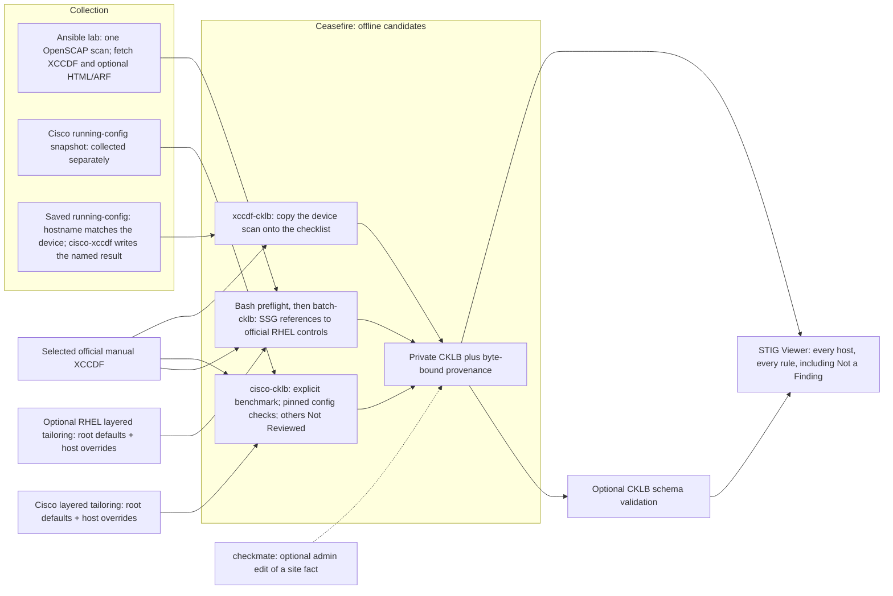

# Ceasefire

Ceasefire is the offline toolkit that turns a saved scan or a saved device configuration into the checklist security opens in STIG Viewer. The admins, network engineers, and cyber staff stop fighting over the paperwork, because the tool decides who does what and keeps the receipts.

`docket` converts the evidence and writes the receipt. `checkmate` is the optional editor for a site fact the scan cannot see. Those command names stay. The git repository is still `burden-of-proof`.

This repository owns the review-conversion policy, reconciliation, CKLB generation, and evidence-side checks. `docket` evaluates files it is given. `cisco-xccdf` scores a saved running configuration only when its `hostname` command matches the device name, writes an XCCDF result named for that device, and applies a tailoring file saved beside that configuration. `xccdf-cklb` copies the result into a checklist, fills the target page with the supplied hostname, FQDN, management IP, and management MAC, and writes a provenance sidecar. A collector outside this archive supplies the configuration. The RHEL lab lives in a separate repository and supplies a versioned, non-secret [asset record](contracts/asset-record-v1.md) for the RHEL `asset-check` handoff. A checksum proves byte identity, not guest or device state.

## Start here

| Need | Read |
| --- | --- |
| Install once, then run RHEL or Cisco the same way | [Install and run](docs/README.md) |
| Recursive RHEL scan pairing, benchmark selection, output and provenance rules | [Batch CKLB converter](docs/BATCH-CKLB.md) |
| Illustrated RHEL path from the lab scan to the reviewer | [RHEL workflow](docs/RHEL-OSCAP-WORKFLOW.md) |
| Layered tailoring: site-wide defaults + per-host overrides with provenance | [Tailoring guide](docs/TAILORING.md) |
| Shared paths for docket and checkmate | [Config](docs/CONFIG.md) |
| One quarter, from the new manuals through archive | [Quarterly runbook](docs/QUARTERLY-RUNBOOK.md) |
| Cisco config evaluation, partial tailoring, and review limits | [Cisco config candidates](docs/CISCO-CONFIG.md) |
| Illustrated Cisco path from a saved configuration to a device-named checklist | [Cisco scan process](docs/CISCO-SCAN-PROCESS.md) |
| Network scan: device-named XCCDF results and checklist identity | [Network scan](docs/NETWORK-SCAN.md) · [Admin walkthrough](docs/NETWORK-ADMIN-WALKTHROUGH.md) |
| CLI commands and retired implementation scope | [Go-only converter](docs/GO-MIGRATION.md) |
| Operational review and external verification | [Workflow](docs/WORKFLOW.md) |
| Exact Ansible/OpenSCAP scan command, captured playbook and fetched artifacts | [Lab scan source](docs/OSCAP-SOURCE.md) |
| Lab-to-evidence v1 handoff fields and limitations | [Asset record contract](contracts/asset-record-v1.md) |
| Package, preflight an initial deployment, and run offline | [Disconnected release](docs/DISCONNECTED-RELEASE.md) |

## Disconnected runtime bundle and initial preflight

The connected build machine needs Go 1.22 or newer. Run `./scripts/package-ceasefire.sh 2.1.0 ./dist/releases` and then `./scripts/install-ceasefire.sh` to build and install the static Linux/amd64 `docket` and `checkmate` binaries. The archive is named `ceasefire-2.1.0-linux-amd64.tar.gz`. `RELEASE.txt` inside it names the product Ceasefire. It includes both CLIs, the Bash installer, bash completion for both commands, the RHEL preflight, a Python 3 Cisco tailoring generator, four per-OS YAML **examples**, partial Cisco root tailoring examples, the pinned [DISA CKLB 1.0 JSON schema](schemas/PROVENANCE.md), README and docs, the asset contract, both non-executable lab-source snapshots, and inner/outer SHA-256 manifests. The packaged CLIs need no Go, Python, or network on the destination; the optional tailoring generator needs Python 3. If the install prefix is not on `PATH`, the installer prints the `export PATH=...` line and still finishes. Verify the archive against an independently trusted expected hash before extraction. Stage one private library and follow [install and run](docs/README.md) and the [quarterly runbook](docs/QUARTERLY-RUNBOOK.md). `docket quarter` runs tailoring check, skips a platform that has no inputs, dry-runs what remains, then writes. `--rhel` and `--cisco` select one platform. `ceasefire-preflight.sh` exits non-zero when tailoring check fails. `cisco-cklb` remains the single-device command; `cisco-xccdf` writes a device-named result and has no preview switch. The generic archive excludes official XCCDF benchmarks, private scans, and device configurations even though this private source repository currently tracks a Cisco benchmark library. See [disconnected release](docs/DISCONNECTED-RELEASE.md).

## Scan and review boundaries

The live scanner remains in `/scratch/ansible`; [its exact command and snapshot](docs/OSCAP-SOURCE.md) are for audit, not a scan entry point in this repository. This playbook performs **one scan** and package updates; it does not generate/apply remediation or automatically produce a post-remediation recheck. If a separate authorized remediation workflow is used, its ignore rules exclude selected fixes, **not** checklist findings; obtain a fresh post-change scan and do not mix runs. **Layered tailoring** uses site-wide root defaults (one file per OS at library root) plus optional per-host overrides (in scan directories); rules merge per-rule with host overrides winning. Root YAML applies to **every host of that OS**; `auto` retains the scan-derived status. The bundled RHEL examples, including a lab-specific `not_a_finding` override, are **not approved site policy**. The converter preserves raw candidates even when a manual decision differs; ARF adds observations only with matching HTML. Cisco tailoring also uses the two-layer architecture with `auto` by default until an administrator changes a rule and supplies a comment. See [tailoring guide](docs/TAILORING.md), [batch converter](docs/BATCH-CKLB.md) and [Cisco guide](docs/CISCO-CONFIG.md).

## What the output means

For RHEL, the converter joins explicit SSG `V-…` or historical `SV-…` references to official DISA manual XCCDF controls by numeric ID. That produces **candidate** statuses, not an official DISA scan or proof that the SSG and DISA checks have equivalent semantics. Missing or ambiguous controls remain Not Reviewed unless an administrator explicitly supplies a per-OS checklist decision in the tailoring YAML. For Cisco, the same evaluator (`cisco-config-review-v9`) scores pinned IOS, IOS-XE, and NX-OS switch checks when the benchmark ID, rule IDs, and official check phrases still match. You still name the benchmark. The tool will not infer IOS from a confident reading of `version`. Anything it cannot prove stays Not Reviewed. A partial tailoring file accounts for the rules an administrator decided and leaves the rest to the scan or the pinned check. It records allowlisted non-secret observations and byte hashes, not raw device configuration. See the [Cisco guide](docs/CISCO-CONFIG.md).

The file security opens is that CKLB in STIG Viewer. The checklist title is the host and the benchmark. Each rule carries the manual's check text, discussion, fix text, and potential impact when the manual has them. The comment leads with the status and what this host showed. Finding details carry that observation. File hashes stay in the provenance sidecar. A Not a Finding is that host's result for this quarter. It is not copied onto the next host, and it is not written into root tailoring, because the next scan has to be free to show drift. `cisco-xccdf` fills the Viewer target page with hostname, FQDN, IP, MAC, and role. `batch-cklb` and `cisco-cklb` record the hostname.

There is no signed-release, signature-verification, or evidence-publication command here. Schema validation, the STIG Viewer review, approval, and delivery require separate authorized steps. `checkmate`, built from `cmd/checkmate` in this module, is the scan admin's optional editor for a site fact the scan cannot see. It inventories, optionally validates, and edits existing CKLBs; editing invalidates the converter's byte-bound sidecar. It is not the converter, the security review tool, or an approval gate. This **private source repository** currently tracks 25 Cisco manual XCCDF files and partial schema v3 root tailoring files under `stig-library-cisco/`; a Git checkout gives them ordinary repository permissions, so stage operational copies in an owner-private library before CLI use. The generic offline archive deliberately omits those benchmarks. Keep actual scans, device snapshots, generated assessments, approval records and keys in owner-private storage outside Git. `.gitignore` is housekeeping, not access control.
