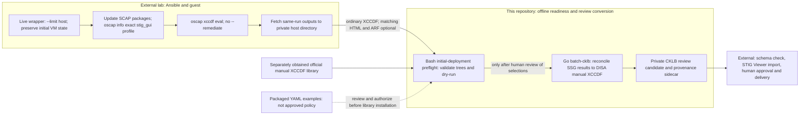

# Burden of Proof

An offline Go toolkit for turning saved OpenSCAP SSG results into **private CKLB review candidates** and byte-bound provenance. This repository owns the review-conversion policy, reconciliation, CKLB generation, and evidence-side checks. It does **not** provision the lab or run a scan. The lab lives in a separate repository and supplies a versioned, non-secret [asset record](contracts/asset-record-v1.md) for the `asset-check` handoff. A checksum proves byte identity, not guest state.

## Start here

| Need | Read |
| --- | --- |
| Build, convert, and understand the verification boundary | [Quick start](docs/README.md) |
| Recursive input pairing, benchmark selection, output and provenance rules | [Batch CKLB converter](docs/BATCH-CKLB.md) |
| CLI commands and retired implementation scope | [Go-only converter](docs/GO-MIGRATION.md) |
| Operational review and external verification | [Workflow](docs/WORKFLOW.md) |
| Exact Ansible/OpenSCAP scan command, captured playbook and fetched artifacts | [Lab scan source](docs/OSCAP-SOURCE.md) |
| Lab-to-evidence v1 handoff fields and limitations | [Asset record contract](contracts/asset-record-v1.md) |
| Package, preflight an initial deployment, and run offline | [Disconnected release](docs/DISCONNECTED-RELEASE.md) |

## Disconnected runtime bundle and initial preflight

Run `./scripts/package-disconnected.sh VERSION ./dist/releases` to test and build a static Linux/amd64 CLI with vendored Go dependencies. The archive includes the executable Bash preflight, four per-OS YAML **examples**, README and docs, the asset contract, both non-executable lab-source snapshots, and inner/outer SHA-256 manifests. It excludes official DISA benchmarks and private scans; the packaged CLI needs no Go toolchain or network on the destination. Verify the archive against an independently trusted expected hash before extraction. After staging private scans and an extracted benchmark library, run `scripts/preflight-offline.sh` with `--converter`, `--input-root`, and `--library-root` **before** the first conversion write; optionally pass a separate Checkmate executable and CKLB root. It validates private trees/checksums and runs `batch-cklb --dry-run` without scanning or changing assessments. See [disconnected release](docs/DISCONNECTED-RELEASE.md) for exact commands and limitations.

## Scan and review boundaries

The live scanner remains in `/scratch/ansible`; [its exact command and snapshot](docs/OSCAP-SOURCE.md) are for audit, not a scan entry point in this repository. This playbook performs **one scan** and package updates; it does not generate/apply remediation or automatically produce a post-remediation recheck. If a separate authorized remediation workflow is used, its ignore rules exclude selected fixes, **not** checklist findings; obtain a fresh post-change scan and do not mix runs. Per-OS YAML in the private STIG library applies comments and optional status decisions to **every host of that OS**; `auto` retains the scan-derived status. The bundled examples, including a RHEL 9 lab-specific `not_a_finding` override, are **not approved site policy**. The converter preserves raw candidates even when a manual decision differs; ARF adds observations only with matching HTML. See [batch converter](docs/BATCH-CKLB.md).

## What the output means

The converter joins explicit SSG `V-…` or historical `SV-…` references to official DISA manual XCCDF controls by numeric ID. That produces **candidate** statuses, not an official DISA scan or proof that the SSG and DISA checks have equivalent semantics. Missing or ambiguous controls remain Not Reviewed unless an administrator explicitly supplies a per-OS checklist decision in the tailoring YAML. Generated CKLB files and their provenance sidecars are review artifacts: their hashes bind bytes, but neither a hash nor an asset record attests guest state, operator approval, or scan authenticity.

There is no signed-release, signature-verification, or evidence-publication command here. Schema validation, human review, STIG Viewer import, approval, and delivery require separate authorized steps. [Checkmate](docs/WORKFLOW.md#checkmate-is-a-separate-tool), when supplied separately, inventories or validates existing CKLBs; it is not the converter or an approval gate. Keep scans, benchmarks, generated checklists, sidecars, approvals, and keys in owner-private storage outside Git. `.gitignore` is housekeeping, not access control.
