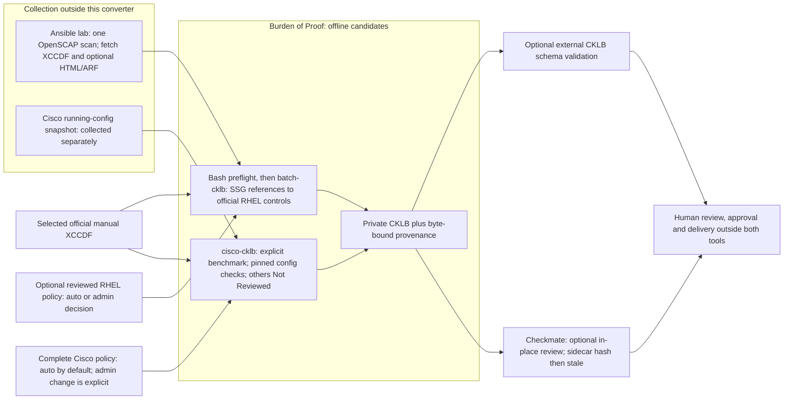

# Burden of Proof

An offline Go toolkit for turning saved OpenSCAP SSG results **or explicitly selected Cisco running configurations** into **private CKLB review candidates** and byte-bound provenance. This repository owns the review-conversion policy, reconciliation, CKLB generation, and evidence-side checks. It does **not** provision the lab, collect device configurations, or run a scan. The lab lives in a separate repository and supplies a versioned, non-secret [asset record](contracts/asset-record-v1.md) for the RHEL `asset-check` handoff. A checksum proves byte identity, not guest or device state.

## Start here

| Need | Read |
| --- | --- |
| Build, convert, and understand the verification boundary | [Quick start](docs/README.md) |
| Recursive RHEL scan pairing, benchmark selection, output and provenance rules | [Batch CKLB converter](docs/BATCH-CKLB.md) |
| Cisco config evaluation, full auto-default tailoring inventory and review limits | [Cisco config candidates](docs/CISCO-CONFIG.md) |
| CLI commands and retired implementation scope | [Go-only converter](docs/GO-MIGRATION.md) |
| Operational review and external verification | [Workflow](docs/WORKFLOW.md) |
| Exact Ansible/OpenSCAP scan command, captured playbook and fetched artifacts | [Lab scan source](docs/OSCAP-SOURCE.md) |
| Lab-to-evidence v1 handoff fields and limitations | [Asset record contract](contracts/asset-record-v1.md) |
| Package, preflight an initial deployment, and run offline | [Disconnected release](docs/DISCONNECTED-RELEASE.md) |

## Disconnected runtime bundle and initial preflight

Run `./scripts/package-disconnected.sh VERSION ./dist/releases` to test and build a static Linux/amd64 CLI with vendored Go dependencies. The archive includes the executable Bash RHEL preflight, a Python 3 Cisco tailoring generator, four per-OS YAML **examples**, the pinned [DISA CKLB 1.0 JSON schema](schemas/PROVENANCE.md), README and docs, the asset contract, both non-executable lab-source snapshots, and inner/outer SHA-256 manifests. The packaged CLI needs no Go, Python, or network on the destination; the optional tailoring generator needs Python 3. Verify the archive against an independently trusted expected hash before extraction. After staging private scans and an extracted benchmark library, run `scripts/preflight-offline.sh` with `--converter`, `--input-root`, and `--library-root` **before** the first RHEL conversion write; optionally pass a separate Checkmate executable and CKLB root. It does not preflight `cisco-cklb`: use that command's `--dry-run` with an explicitly chosen Cisco benchmark. The optional `--schema schemas/SV3_CKLB_1_0_JSON_SCHEMA.json` runs Checkmate validation when both Checkmate arguments are supplied; it does not make the converter validate CKLBs. The generic archive excludes official XCCDF benchmarks, private scans and device configurations even though this private source repository currently tracks a Cisco benchmark/policy library. See [disconnected release](docs/DISCONNECTED-RELEASE.md) for exact commands and limitations.

## Scan and review boundaries

The live scanner remains in `/scratch/ansible`; [its exact command and snapshot](docs/OSCAP-SOURCE.md) are for audit, not a scan entry point in this repository. This playbook performs **one scan** and package updates; it does not generate/apply remediation or automatically produce a post-remediation recheck. If a separate authorized remediation workflow is used, its ignore rules exclude selected fixes, **not** checklist findings; obtain a fresh post-change scan and do not mix runs. Per-OS YAML in the private STIG library applies comments and optional status decisions to **every host of that OS**; `auto` retains the scan-derived status. The bundled RHEL examples, including a lab-specific `not_a_finding` override, are **not approved site policy**. The converter preserves raw candidates even when a manual decision differs; ARF adds observations only with matching HTML. Cisco's complete, hash-bound tailoring inventory has `auto` for every check until an administrator changes a rule and supplies a comment. See [batch converter](docs/BATCH-CKLB.md) and [Cisco guide](docs/CISCO-CONFIG.md).

## What the output means

For RHEL, the converter joins explicit SSG `V-…` or historical `SV-…` references to official DISA manual XCCDF controls by numeric ID. That produces **candidate** statuses, not an official DISA scan or proof that the SSG and DISA checks have equivalent semantics. Missing or ambiguous controls remain Not Reviewed unless an administrator explicitly supplies a per-OS checklist decision in the tailoring YAML. For Cisco, `cisco-cklb` binds a saved configuration to the **operator-selected exact Cisco benchmark**. The pinned IOS-XE Switch L2S V3R2 evaluator can decide two global STP checks from a suitable config snapshot; unsupported or ambiguous checks remain Not Reviewed. A complete all-`auto` policy accounts for every rule without manufacturing findings. The evaluator's restrained use of "unknown" is intentional, if not particularly dramatic. It records allowlisted non-secret observations and byte hashes, not raw device configuration. See the [Cisco guide](docs/CISCO-CONFIG.md). Generated CKLB files and their provenance sidecars are review artifacts: their hashes bind bytes, but neither a hash nor an asset record attests guest/device state, operator approval, or scan authenticity.

There is no signed-release, signature-verification, or evidence-publication command here. Schema validation, human review, STIG Viewer import, approval, and delivery require separate authorized steps. [Checkmate](docs/WORKFLOW.md#checkmate-is-a-separate-tool), when supplied separately, inventories, optionally validates, and edits existing CKLBs; editing invalidates the converter's byte-bound sidecar. It is not the converter or an approval gate. This **private source repository** currently tracks 25 Cisco manual XCCDF files and their 25 all-`auto` tailoring inventories under `stig-library-cisco/`; a Git checkout gives them ordinary repository permissions, so stage operational copies in an owner-private library before CLI use. The generic offline archive deliberately omits those benchmarks and policies. Keep actual scans, device snapshots, generated assessments, approval records and keys in owner-private storage outside Git. `.gitignore` is housekeeping, not access control.
