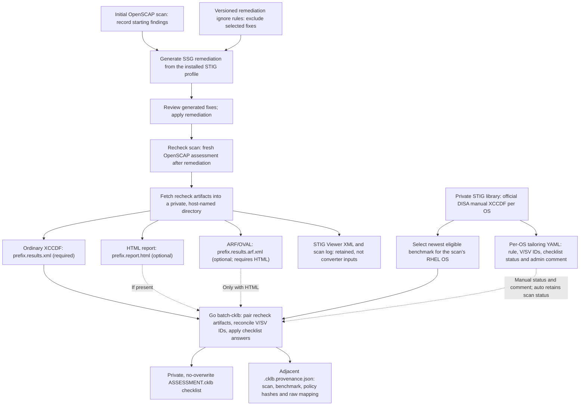

# Burden of Proof

An offline Go toolkit for turning saved OpenSCAP SSG results into **private CKLB review candidates** and byte-bound provenance. This repository owns the review-conversion policy, reconciliation, CKLB generation, and evidence-side checks. It does **not** provision the lab or run a scan. The lab lives in a separate repository and supplies a versioned, non-secret [asset record](contracts/asset-record-v1.md) for the `asset-check` handoff. The boundary is intentional; a checksum is not a character reference for the guest.

## Start here

| Need | Read |
| --- | --- |
| Build, convert, and understand the current verification boundary | [Quick start](docs/README.md) |
| Recursive input pairing, benchmark selection, output and provenance rules | [Batch CKLB converter](docs/BATCH-CKLB.md) |
| CLI commands and retired implementation scope | [Go-only converter](docs/GO-MIGRATION.md) |
| Operational review and external verification | [Workflow](docs/WORKFLOW.md) |
| Exact Ansible/OpenSCAP scan command, captured playbook and fetched artifacts | [Lab scan source](docs/OSCAP-SOURCE.md) |
| Lab-to-evidence v1 handoff fields and limitations | [Asset record contract](contracts/asset-record-v1.md) |
| Package and run without internet access | [Disconnected release](docs/DISCONNECTED-RELEASE.md) |

## Disconnected runtime bundle

Run `./scripts/package-disconnected.sh VERSION ./dist/releases` to test and build a static Linux/amd64 CLI with the vendored Go dependencies, four per-OS YAML templates, documentation and SHA-256 manifests. The packaged CLI needs no Go toolchain or public network on the destination. Supply official DISA benchmarks and private scans separately; the templates are examples, not packaged benchmarks. Verify the archive using an independently trusted expected hash before extraction. See [disconnected release](docs/DISCONNECTED-RELEASE.md) for the transfer, verification and installation steps.

## OpenSCAP remediation to CKLB data flow

The initial scan, remediation, recheck scan, and artifact transfer occur outside this Go repository. The current lab's [Ansible playbook and exact `oscap xccdf eval` command](docs/OSCAP-SOURCE.md) are captured separately for audit; the live scanner remains in `/scratch/ansible`. Use a fresh recheck bundle for conversion; do not pair its XCCDF with an earlier run's HTML or ARF. Remediation ignore rules control which fixes are generated, **not** checklist results. The per-OS YAML in the private STIG library supplies administrator comments and optional status decisions for every host of that OS; `auto` retains the scan-derived status. The converter keeps raw scan candidates in provenance even when an administrator selects a different checklist status. ARF enriches observations only when the matching HTML report is present. See [batch converter](docs/BATCH-CKLB.md) for pairing, privacy, and benchmark-selection rules.

## What the output means

The converter joins explicit SSG `V-…` or historical `SV-…` references to official DISA manual XCCDF controls by numeric ID. That produces **candidate** statuses, not an official DISA scan or proof that the SSG and DISA checks have equivalent semantics. Missing or ambiguous controls remain Not Reviewed unless an administrator explicitly supplies a per-OS checklist decision in the tailoring YAML. Generated CKLB files and their provenance sidecars are review artifacts: their hashes bind bytes, but neither a hash nor an asset record attests guest state, operator approval, or scan authenticity.

There is no signed-release, signature-verification, or evidence-publication command here. Schema validation, human review, STIG Viewer import, approval, and delivery require separate authorized steps. Keep scans, benchmarks, generated checklists, sidecars, approvals, and keys in owner-private storage outside Git. `.gitignore` is housekeeping, not access control.
