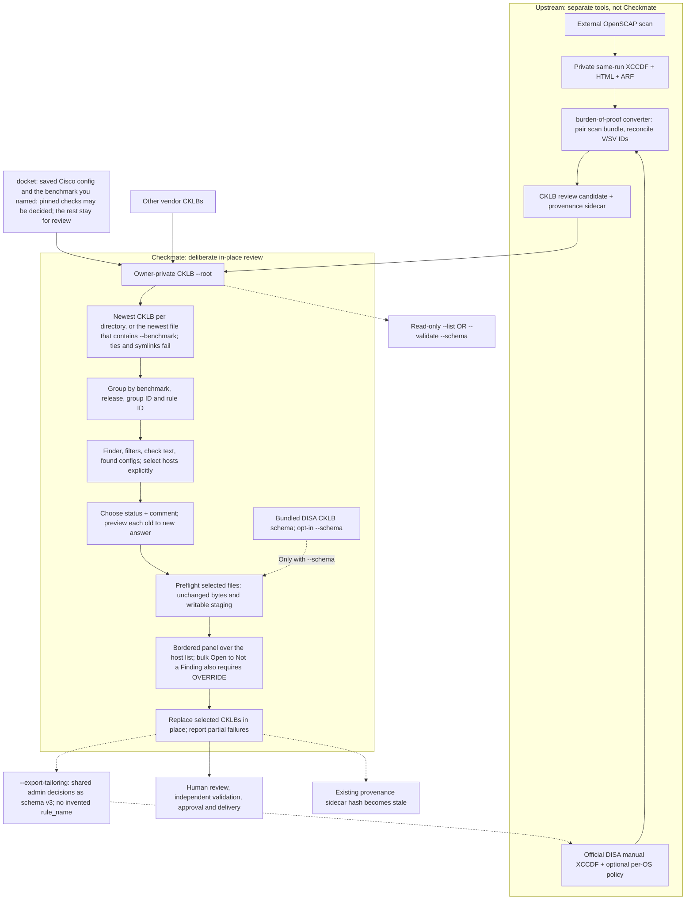
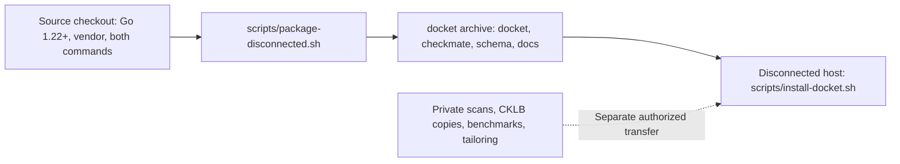

# Checkmate

A terminal editor for STIG Viewer `.cklb` checklists. It reads CKLB JSON, so Cisco IOS, RHEL, and other benchmarks all get the same treatment. Apparently the paperwork is the one platform everyone agreed to standardize.

Checkmate edits checklist answers. It does **not** run scans, assess a host, approve a control, or make an incorrect answer correct by displaying it in a handsome terminal.

## Primary workflow



Checkmate refuses to decide for you. It has a finder, a confirm panel, and an optional benchmark so a mixed root does not become a group project. `--export-tailoring` writes the rows every selected host already shares as a schema v3 docket tailoring candidate. It does not invent `rule_name`. An explicit status in that file replaces the next scan. Start with `--root DIR --list` to inspect the discovered files; `--root DIR --validate --schema PATH` is an optional **read-only** check, not an edit or a signoff. `--export-tailoring` is read-only too. The converter is `docket`, in this same module. Its Cisco evaluator can decide the pinned IOS, IOS-XE, and NX-OS switch checks. A partial tailoring file does not answer the controls it omits. In the editor, no hosts start selected. Filter and inspect each host, explicitly select only those sharing a justified answer, preview the exact old → new status and comment, then confirm. A common control ID is not a fleet-wide finding. Checkmate does not regenerate the converter's provenance, make a multi-file edit transactional, or replace a human approval process. For RHEL 7–10 practice inputs, see [offline examples](docs/OFFLINE-EXAMPLES.md). For invented Cisco configurations, see [the synthetic guide](examples/cisco-synthetic/GUIDE.md). Neither path is a substitute for independent evidence.

## Run locally

You need Go 1.22 or newer to build it from this checkout. The resulting binary does not need Go. From the repository root:

```sh
export GOPROXY=off GOSUMDB=off GOTOOLCHAIN=local GOFLAGS=-mod=vendor CGO_ENABLED=0
go build -mod=vendor -o dist/checkmate ./cmd/checkmate
dist/checkmate --root "$HOME/private/stig/completed_ckl" --list
dist/checkmate --root "$HOME/private/stig/completed_ckl" --benchmark Cisco_IOS_STIG --list
dist/checkmate --root "$HOME/private/stig/completed_ckl"
dist/checkmate --root "$HOME/private/stig/completed_ckl" --benchmark Cisco_IOS_STIG
dist/checkmate --root "$HOME/private/stig/completed_ckl" --schema "$PWD/schemas/SV3_CKLB_1_0_JSON_SCHEMA.json"
dist/checkmate --root "$HOME/private/stig/completed_ckl" --validate --schema "$PWD/schemas/SV3_CKLB_1_0_JSON_SCHEMA.json"
dist/checkmate --root "$HOME/private/stig/completed_ckl" --benchmark RHEL_9_STIG --export-tailoring "$HOME/private/stig/tailoring_export"
```

`--schema` is **opt-in**. Without it, Checkmate still requires parseable CKLB JSON, STIG/rule data, IDs, and a supported status, but does **not** run full JSON Schema validation. `--validate` requires `--schema` and checks every selected newest checklist without entering the TUI; `--list` is an inventory, not schema validation, and cannot be combined with either flag. With `--schema` in editor mode, every **selected file** is schema-checked during batch preflight before any write. The tool does not silently consult a default schema. `--export-tailoring` is also read-only: it does not edit CKLBs and cannot be combined with `--list`, `--validate`, or `--schema`.

Point `--root` at a directory of completed checklists. Checkmate walks it and selects the most recently modified `.cklb` **in each directory**. A tie for newest, invalid *basic* CKLB data, or a symlink in the tree stops the run. Guessing which assessment you meant would be a bold feature for a compliance tool. Other files are ignored. If one directory has multiple benchmark checklists, only its newest CKLB is considered; put independent checklists in separate directories.

`--benchmark STIG_ID` is optional. The value is a CKLB `stig_id`, matched exactly, for example `Cisco_IOS_STIG` or `RHEL_9_STIG`. Checkmate then keeps, in each directory, the newest file that contains that benchmark, so a newer checklist for a different benchmark does not hide it. Rules from any other benchmark in the chosen file stay out of the session. Omit `--benchmark` and every newest checklist opens, same as before. A name that matches nothing stops the run and lists the benchmark IDs that were present. `--list`, `--validate`, and `--export-tailoring` honor the same choice.

Controls are grouped by benchmark ID, release text, group ID, and rule ID. Matching numbers from unrelated products or revisions do not earn a group photo together.

## Inputs, layout, and permissions

Only the completed `.cklb` tree is required by Checkmate. The optional DISA CKLB schema is bundled at `schemas/SV3_CKLB_1_0_JSON_SCHEMA.json` but must still be supplied explicitly with `--schema`. `stig_library` is **not a Checkmate input**: it belongs to the scan-to-checklist converter and may contain private DISA XCCDF benchmarks and per-OS tailoring YAML. Do not pass it as `--root`, and do not bundle its contents with Checkmate. Checkmate does not read XML, YAML, HTML, ARF, or provenance sidecars.

Example owner-private layout (mode recommendations shown; Checkmate does not change directory permissions):

```text
$HOME/private/stig/                                   0700  owner directory
├── schema/                                           0700  optional installed copy
│   └── SV3_CKLB_1_0_JSON_SCHEMA.json                 0600  bundled JSON, not the ZIP
├── stig_library/                                     0700  converter only; optional here
│   ├── U_RHEL_9_STIG_V2R10_Manual-xccdf.xml          0600  example benchmark
│   └── RHEL_9_STIG.tailoring.yaml                    0600  example policy
└── completed_ckl/                                   0700  pass THIS as --root
    ├── rhel9-node1/                                 0700
    │   ├── older.cklb                               0600  ignored if newer exists
    │   └── newer.cklb                               0600  selected by modification time
    └── switch1/                                    0700
        └── assessment.cklb                          0600
```

The account running Checkmate must be able to traverse and read every directory/file under `--root`; for edits it must also be able to create and rename a temporary file in **each selected CKLB's parent directory**. Parent-directory write permission matters even if the CKLB itself is readable. Use an owner-controlled tree and avoid concurrent writers. A private layout can be prepared without granting other users access:

```sh
umask 077
install -d -m 700 "$HOME/private/stig" "$HOME/private/stig/schema" \
  "$HOME/private/stig/completed_ckl" \
  "$HOME/private/stig/completed_ckl/rhel9-node1"
# Leave stig_library absent if you intend to create it with the extractor below.
install -m 600 /secure/incoming/assessment.cklb \
  "$HOME/private/stig/completed_ckl/rhel9-node1/assessment.cklb"
```

If your private checklist tree is `/scratch/src/admin/stig/completed_ckl`, use `--root /scratch/src/admin/stig/completed_ckl` after checking its ownership and modes; the neighboring `stig_library` is for the converter, not this editor. Work on a private **copy** when testing edits; `--list` and `--validate` are read-only.

### Optional schema requirements

- The repository and the docket release archive include the unmodified JSON extracted from DISA's [STIG Viewer 3 CKLB 1.0 schema ZIP](https://dl.dod.cyber.mil/wp-content/uploads/stigs/zip/SV3_CKLB_1_0_JSON_SCHEMA.zip). SHA-256: `8b88205de07662006e1660b1decad677d344828d6687b1dd26bca15105b7bb37`. See [schema provenance and licensing caveat](../../schemas/PROVENANCE.md). The ZIP itself is not accepted by `--schema`.
- `--schema` must name a **readable local regular `.json` file**, not a symlink. It must declare `$schema` as `https://json-schema.org/draft/2019-09/schema`. Internal references work; external file or network references are not loaded. The file's parent directories must be traversable. Owner-controlled `0700` directories and `0600` files are recommended.
- The CLI checks the supplied file's format and draft, **not its provenance or checksum**. A different Draft 2019-09 schema may compile but is not DISA validation. Schema validity does not prove a finding correct or a checklist importable in STIG Viewer.
- The upstream ZIP has no explicit redistribution notice; the repository's license does **not** apply to this third-party schema. Verify your organization's authority before sharing the bundle beyond authorized recipients. The validator library and its Draft 2019-09 meta-schemas remain vendored for disconnected builds.

To install a private copy, run this from the repository root (or the extracted docket archive, which has the same `schemas/` directory):

```sh
install -m 600 schemas/SV3_CKLB_1_0_JSON_SCHEMA.json \
  "$HOME/private/stig/schema/SV3_CKLB_1_0_JSON_SCHEMA.json"
sha256sum "$HOME/private/stig/schema/SV3_CKLB_1_0_JSON_SCHEMA.json"
# Compare with the published JSON hash above; Checkmate does not do that comparison for you.
```

## Prepare a private library and scan results

These helper scripts live in `cmd/checkmate/scripts/` and are run from that directory. Checkmate takes a completed CKLB `--root`. It does not read the STIG library or import OpenSCAP results. The disconnected bundle that installs both binaries is `scripts/package-disconnected.sh` in the repository root.

To extract a new library from official RHEL or Cisco STIG ZIPs, or a directory containing ZIPs **directly** (not recursively), choose a destination that does not exist. The script streams only RHEL `U_RHEL_N_STIG_VxRy_Manual-xccdf.xml` and Cisco `U_Cisco_*STIG_VxRy_Manual-xccdf.xml` / `U_Cisco_*VxRy_STIG_Manual-xccdf.xml` entries to a flat, owner-private directory. Cisco filenames include IOS/IOS-XE/IOS-XR Router and Switch, ASA, ACI, ISE, NX-OS and SNA variants; for example `U_Cisco_IOS_Router_NDM_STIG_V3R9_Manual-xccdf.xml` and `U_Cisco_ACI_RTR_Manual_V1R2_STIG_Manual-xccdf.xml`. It does not unpack PDFs, scripts, or arbitrary archive paths, does not overwrite a library, and fails on duplicate benchmark filenames. The destination's parent must already exist, be owned by you, and not be group/world writable. Source ZIPs should be obtained and verified under your organization's DISA distribution procedures; this script does not authenticate an archive or validate the XCCDF's identity.

```sh
# Example: SOURCE contains U_RHEL_9_...STIG.zip, U_Cisco_IOS_Router_...STIG.zip, etc.
./scripts/unpack-stig-library.sh \
  /scratch/src/admin/stig/stig_library_source_archives \
  "$HOME/private/stig/stig_library"
# Or use an individual ZIP as the first argument.
# Parent directory: owned by caller, not group/world writable.
# New library directory: 0700; extracted XML files: 0600.
```

Only versions actually present in the source are extracted; if a RHEL release or Cisco benchmark is missing, this script cannot supply it. `docket batch-cklb` reads RHEL XCCDF results, and `docket cisco-cklb` reads a saved running configuration against the benchmark you name. Extraction alone does not classify controls. Optional `RHEL_N_STIG.tailoring.yaml` policies are **not** in the ZIP and must be placed at the library root separately, as owner-owned regular files with mode `0600`. The converter also checks benchmark identity/release metadata when it uses one.

For an existing, owner-controlled OpenSCAP results tree, inspect its proposed permission changes first. `--apply` changes **all** directories beneath the requested root to `0700` and **all** regular files to `0600`, including unrelated files in that tree. It does not change contents or ownership, and aborts before changing modes if it encounters a symlink, multiply-linked regular file, special file, foreign-owned entry, unreadable subtree, or no recognizable XCCDF result. Use the narrow results root you intend, not a parent that also contains the library. Do not run it while another process is modifying the tree; chmod across multiple files is not atomic, so a runtime failure can leave earlier entries changed.

```sh
./scripts/fix-oscap-permissions.sh /path/to/oscap-results
./scripts/fix-oscap-permissions.sh --apply /path/to/oscap-results
# Then use: docket batch-cklb --input-root /path/to/oscap-results \
#   --library-root "$HOME/private/stig/stig_library" --dry-run
```

The path must be canonical and absolute (no symlink components); the script refuses `/` and your home directory. A recognized result ends in `.results.xml`, `.results.xccdf.xml`, or `_XCCDF_Results.xml`. Permission repair does not make an incomplete or misnamed scan bundle compatible: the converter still requires its expected same-prefix companions and valid scan content. The scripts use Bash, GNU coreutils/find, and `unzip` (for extraction); test them with `bash tests/permissions-scripts.sh` on synthetic fixtures before operating on valuable evidence.

## Drive the terminal

- `j/k` or arrows: move between controls. `Tab`: focus a host. `Space`: include or exclude that host from the edit. Nothing starts selected; Checkmate has resisted the temptation to decide for your entire fleet. `Esc` clears a notice. `q` quits. `Esc` used to leave the building; that was a bold reading of cancel.
- `PgUp/PgDn`: move through affected hosts a page at a time. `Home/End`: jump to the first or last host; `Shift+Tab`: focus the previous host. The confirmation panel pages its selected-host list too. Fifty hosts no longer require a fifty-line terminal and a prayer. Each row shows the host and its status. The full path stays on the focused line, where a long directory can be admired without shoving the status off the screen.
- `f`: cycle status filters; `F`: cycle severity filters. `/` opens a finder for benchmark, group ID, rule ID, and title. `h` opens one for hosts. Both are bordered panels, because typing into the footer was how clues went to die. Type to filter, up and down to move, Enter to accept, Esc to restore the previous query. `ctrl+u` clears the line. `ctrl+w` drops the last word. Filtering does not select hosts. Selection remains a conscious act, tragically.
- `m`: replace this control's selection with hosts matching the active status filter (within the host search); with the default `all` filter, it clears selection. `A`: select every host on this rule, including hosts the search is hiding. The host line says how many are hidden. It will not pretend your search was a moral boundary. `c`: deselect every host on this rule. Quite the demanding letter.
- The browse screen shows the rule's check text under the host list, then the configuration recorded for the selected hosts. With nothing selected, that finding is the focused host. Hosts that recorded the same finding are named together. Hosts that differ get separate blocks, so a fleet of "mostly the same" does not collapse into one convenient sentence. `v` pages the full check text, every found configuration in the selection, and the comment. In the confirmation panel, `v` opens a paged old/new preview for the focused selected host; `Tab` moves to the next selected host.
- `e`: edit selected hosts. Choose `1` Open, `2` Not a Finding, `3` Not Applicable, or `4` Not Reviewed. Type a required comment (`Ctrl+J` inserts a newline), then Enter. The host list stays up. A bordered panel shows the old status, the new status, the comment, and how many hosts were in each old state. The footer under that panel is the confirm keys, not the browse keys wearing a disguise. `y` applies; `n` or Esc cancels. A successful edit clears the selection and leaves the notice until you move, so the success line is not immediately replaced by your next accident. Bulk Open → Not a Finding also requires typing `OVERRIDE`. That is not evidence; it is a speed bump with manners.

All four existing states are editable. **Select only hosts that actually share the decision**; a shared STIG ID is not a shared configuration. Full comments and finding details can be paged for review.

Status badges follow the [STIG Viewer 3.x guide](https://dl.dod.cyber.mil/wp-content/uploads/stigs/pdf/U_STIG_Viewer_3-x_User_Guide_V1R7.pdf): Open is red, Not a Finding green, Not Applicable black on a pale badge, and Not Reviewed gray. The symbols and labels remain visible in a monochrome terminal; even the colors know better than to be your sole source of evidence.

## What an edit actually does

Checkmate replaces the status and comment for each selected control in its existing CKLB. Other JSON fields are preserved, although the JSON formatting is rewritten. It stages each file beside the original, syncs it, retains its permissions, and renames it over the original. Before the batch, it checks **all selected files** for unchanged bytes and ability to stage replacements; with `--schema`, it also validates them against the supplied schema. Each edit checks its file again before writing. A small mercy for anyone else with the same bright idea.

A multi-file edit is **not transactionally atomic**. If a later file fails, earlier files remain changed; the TUI reports how many succeeded. Do not edit the same checklists concurrently or run the tool on a tree writable by an untrusted process.

**Important:** Existing `.cklb.provenance.json` sidecars are not changed. Their recorded CKLB hashes become stale. Checkmate does not sign output or establish that a bulk decision is correct for every host. Keep a separate backup before editing irreplaceable assessments.

## Disconnected installation

From the repository root, on a build host with Go 1.22 or newer and the vendored modules:

```sh
./scripts/package-disconnected.sh 2.1.0 ./dist/releases
(cd ./dist/releases && sha256sum -c docket-2.1.0-linux-amd64.tar.gz.sha256)
./scripts/install-docket.sh --prefix "$HOME/.local" ./dist/releases/docket-2.1.0-linux-amd64.tar.gz
```

The archive contains `bin/docket`, `bin/checkmate`, bash completion for both, the installer, the preflight, the DISA JSON schema, and its [provenance notice](../../schemas/PROVENANCE.md). It does **not** contain private checklists, scan evidence, or benchmarks. The build uses `GOPROXY=off`, `GOSUMDB=off`, `GOTOOLCHAIN=local`, and `CGO_ENABLED=0`. The target is Linux amd64. If `$HOME/.local/bin` is not on `PATH`, the installer prints the `export` line and still finishes. Completion is installed under the prefix even when the system completion directory is not writable.



For a **read-only deployment check**, use `scripts/preflight-offline.sh` from this repository. Supply `docket`, the private scan and benchmark roots, and `checkmate` plus a completed-checklist root. It checks private tree ownership and any root `SHA256SUMS`, runs `tailoring check`, runs `batch-cklb --dry-run`, and runs `checkmate --list` (plus `--validate` only if you supply a schema). A tailoring check failure exits non-zero. It does not scan hosts or edit checklists. See the [offline examples guide](docs/OFFLINE-EXAMPLES.md#read-only-deployment-preflight). A dry run is **not** approval to use example tailoring as site policy.

## Export candidate tailoring

`--export-tailoring DIR` reads the selected CKLBs and writes docket tailoring **candidates**. It does not edit checklists, does not read an existing tailoring file, and does not install anything into a STIG library. One file is written per benchmark: `STIG_ID.tailoring.yaml`. A rule is included only when every selected checklist that contains that benchmark and release has the same status and the same comment. Hosts that disagree are omitted. Checkmate will not invent a majority. Two releases of the same benchmark stop the run rather than collapse into one library file.

`not_reviewed` with an empty comment, or a comment containing `NOT REVIEWED`, `placed on the DISA rule id`, `saved running configuration on this device`, or the converter's `DRAFT:` mapping sentence, is left out. Any other shared row is copied with its status. A `not_reviewed` row whose comment is an administrator's reason stays `not_reviewed`. It is not rewritten to `auto`. `open`, `not_a_finding`, and `not_applicable` are copied as explicit statuses. An explicit status replaces the scan result for **every** host converted with that library. The export cannot tell a reviewed decision from last quarter's scan result that merely happened to match. Read the file, and delete rows that are not policy, before it becomes site policy.

The export is schema version 3. It has no `rule_name` and no real benchmark hash (`benchmark_sha256` is `rehash-me` until `docket tailoring rehash`). `rule_name` is optional in docket and is not stored in CKLB JSON, so checkmate does not invent one. Plain scan passes and untouched NOT REVIEWED text are omitted. Comments containing `placed on the DISA rule id` or `saved running configuration on this device` are not exported. Only rows every selected host shares, with a real administrator comment or a manual status, are written.

The output directory is created at mode `0700` when it is missing. A symlink is refused. Each new file is mode `0600`. An existing file stops the run before anything is replaced. `--benchmark` limits the export the same way it limits `--list`.

```sh
install -d -m 700 "$HOME/private/stig/tailoring_export"
checkmate --root "$HOME/private/stig/completed_ckl" \
  --benchmark RHEL_9_STIG \
  --export-tailoring "$HOME/private/stig/tailoring_export"
```

After you read the file and delete rows that are not site policy, install it beside the manual XCCDF at the library root, mode `0600`, and run `docket tailoring rehash`:

```sh
install -m 600 "$HOME/private/stig/tailoring_export/RHEL_9_STIG.tailoring.yaml" \
  "$HOME/private/stig/stig_library/RHEL_9_STIG.tailoring.yaml"
```

The next `docket batch-cklb` can select it. Tailoring applies to every host of that benchmark. A host-specific answer does not belong in it. See the [offline examples guide](docs/OFFLINE-EXAMPLES.md) for the library layout. Checkmate does not run docket and does not decide that the export is approved.

For a quarterly rescan, review one quarter in the editor, export the rows every host already shares, rehash the pin, and point the next conversion at that library. The following quarter still needs a person for new findings and for anything the hosts did not agree on.

## Development

```sh
GOPROXY=off GOSUMDB=off GOTOOLCHAIN=local GOFLAGS=-mod=vendor go test ./...
```

Run that from the repository root. The module vendor tree is `vendor/` at that root. Keep new source scans and assessments outside this repository. This checkout tracks selected `examples/` fixtures and `benchmarks/` content. Those are source-tree contents, not ingredients in the runtime archive. Do not edit or add private assessment data to the repository. Stage practice copies in an owner-private directory outside the checkout (see the [offline examples guide](docs/OFFLINE-EXAMPLES.md)).

## TODO: disconnected deployment notes

Open items found during the first air-gapped end-to-end deployment. Notes will be appended as issues are discovered.

### Install / packaging

- [ ] ...

### Configuration

- [ ] ...

### Usage / workflow

- [ ] ...

### Docs fixes

- [ ] ...

### Bugs / follow-ups

- [ ] ...
