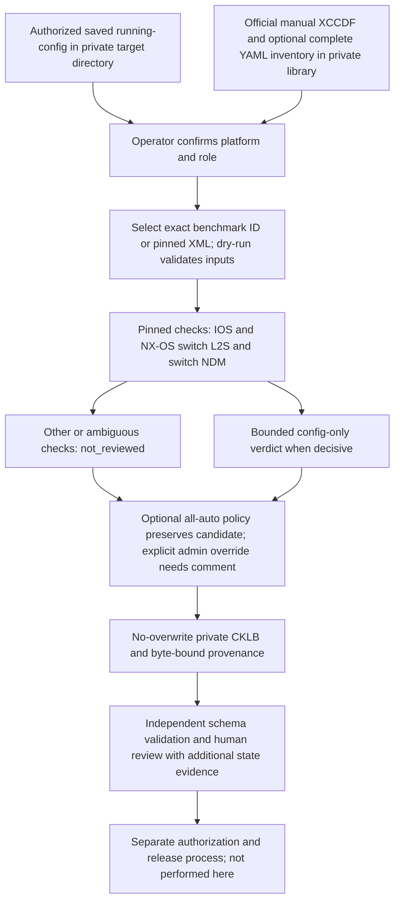

# Cisco running-config review candidates

The shared install, library, and command choice are in [install and run](README.md). This page is what the pinned checks will and will not decide. The tool is not shy about the second list.

The repository tracks `stig-library-cisco/`: 25 official manual XCCDF XMLs and 25 complete, hash-bound, all-`auto` YAML inventories covering 1,096 controls. Inventory is not assessment; a well-filled filing cabinet is still a filing cabinet. These files are **not** included in the generic offline archive. A Git checkout does not preserve the converter's required private modes: copy only authorized XML/policies into an owner-owned `0700` library, set each file to `0600`, and verify source authenticity and benchmark applicability independently. Do not run conversion against the checkout's ordinary `0755`/`0644` files or commit operational configs/decisions.

`stig-evidence cisco-cklb` scores one saved running configuration against one official Cisco manual benchmark. `stig-evidence cisco-batch` does that for every device and benchmark in a manifest and writes a separate review folder for each, plus an HTML index a reviewer can open. Pinned checks cover IOS and IOS-XE switch NDM controls that are decided by global commands, and IOS, IOS-XE, and NX-OS switch L2S controls that can be decided from the configuration together with a port-role table. Every other control stays `not_reviewed`. The tool does not connect to a device, infer platform or role from the configuration, or copy raw configuration lines into the checklist.



## Inputs and selection

Use an owner-owned, mode-`0700` directory named exactly for the device. Place an owner-owned, mode-`0600` UTF-8 snapshot ending in `.running-config` inside it. The CLI requires an explicit `--target` matching that directory. Supply either one owner-private Cisco manual XCCDF XML with `--benchmark` or an owner-private library and **exact** `--benchmark-id`, for example `Cisco_IOS_Router_NDM_STIG`. A router may require separate NDM and RTR benchmarks; use a separate invocation for each. The library selector chooses the newest V/R pair for that exact ID, refuses equal-version duplicates, and checks XCCDF identity and release metadata against the file name. It does **not** guess IOS vs IOS-XE, router vs switch, or NDM vs RTR from config text. Never use a benchmark for a different platform or role merely because it was in the same ZIP.

```sh
stig-evidence cisco-cklb \
  --config /private/configs/router1.example.test/scan.running-config \
  --target router1.example.test \
  --library-root /private/stig-library \
  --benchmark-id Cisco_IOS_Router_NDM_STIG \
  --dry-run
# Remove --dry-run only after independently confirming device identity and benchmark applicability.

stig-evidence cisco-batch \
  --manifest /private/configs/review-manifest.json \
  --evidence-root /private/configs \
  --library-root /private/stig-library \
  --output-root /private/cisco-review \
  --dry-run
```

`cisco-batch` reads `schema_version: 1` and a `devices` list. Each device has `host`, `platform` (`ios`, `ios-xe`, or `nxos`), and the exact benchmark IDs to run. The host directory must be named for that host and contain `scan.running-config`. The `hostname` command must match the directory name. A switch that uses the per-port checks also has `port-roles.csv` with the header `interface,role,user_facing,fiber`. Roles are `user`, `uplink`, `unused`, `access-switch`, and `routed`. The batch writes `--output-root/<benchmark-id>/<host>/` so NDM, L2S, and RTR stay visible together, plus `index.html`.

## Full Cisco tailoring inventory

For each selected Cisco benchmark, the CLI optionally loads `<exact-benchmark-id>.tailoring.yaml` **beside that benchmark XML** (whether selected via `--benchmark` or `--library-root`). A policy is required to list **every current V/SV pair exactly once** and bind the exact benchmark SHA-256; stale, incomplete, duplicate, mismatched, non-private or malformed policies fail before any output is written. One YAML document with only `schema_version: 1`, `benchmark_id`, `benchmark_sha256`, and a `rules` list is accepted. Each rule has `stig_id`, `sv_id`, and `status: auto` by default, with no `comment`. `auto` leaves the native evaluator's **status, comments and finding details unchanged**, including `not_reviewed` when no trustworthy static check exists.

An administrator can deliberately change one `status` to `open`, `not_a_finding`, `not_applicable`, or `not_reviewed`, **and must add a nonempty `comment`** explaining the decision. A file beside the benchmark applies to every device that does not have its own copy. A host exception is `<benchmark-id>.tailoring.yaml` in that device's directory, next to `scan.running-config`, not a second cloned library. Never place sensitive material in comments copied into the CKLB. The checklist preserves the prior automated candidate in `finding_details`, marks the admin decision in `comments`, and records exact overridden V/SV IDs, before/after status, and policy path/hash in provenance. Exact policy bytes change the CKLB ID and output filename, preserving older checklists. Without a policy, output identity stays on evaluator `cisco-config-review-v9`. An all-`auto` policy does **not** make unsupported rules compliant; it accounts for every rule in the inventory.

`cisco-batch` also writes a per-device `<checklist>.tailoring.yaml` beside each review page. Scored controls are `status: auto`. Not Reviewed controls keep a comment that says which fact is missing. An administrator edits those rows, then copies the file to the device directory as `<benchmark-id>.tailoring.yaml`. The next run applies that file to that device only. A file beside the benchmark still applies to every device that does not have its own copy.

`python3 scripts/generate-cisco-tailoring.py --library-root PRIVATE_CISCO_LIBRARY --dry-run` previews a *new* full inventory; omit `--dry-run` to create the YAML beside each private XML. It refuses to overwrite existing policies, including staged copies of the tracked all-`auto` inventories. Keep **operational** policy changes and device configs out of Git and generic releases. Re-generate and deliberately merge any administrator edits after a benchmark revision; do not silently carry overrides to a new V/SV revision.

## CKLB and evidence boundary

The output uses the same CKLB `stigs`/`rules` field structure as RHEL conversion. Its target is the explicit device name and its rule IDs come from the selected official benchmark. A pinned check fires only when the benchmark ID, V-ID, SV-ID, requirement version, title fragment, and official check phrases still match. Loop Guard is Not a Finding only when the global command is present and no interface has `spanning-tree guard none`. Rapid STP is Not a Finding only when the port-role table records an uplink or access-switch port and the mode is Rapid STP or MSTP. Banner text and macro bodies are not commands. A complete IOS snapshot ends with `end`; a missing command on a complete snapshot can be Open. An incomplete snapshot does not turn a missing command into a finding.

Finding details bind the raw running-config and benchmark SHA-256 values and record an allowlisted observation. Raw configuration lines are never copied. The provenance sidecar binds the CKLB bytes, config and benchmark paths/hashes, optional port-role hash, evaluator version `cisco-config-review-v9`, and per-status counts. Output filenames incorporate a versioned digest. An unchanged run verifies and skips identical outputs. Existing differing output is never silently overwritten.

A CKLB candidate is not an approved checklist. Review Open, Not Applicable, and Not Reviewed first, then spot-check Not a Finding. `cisco-batch` already places each benchmark in its own directory, which is the layout Checkmate can inventory without hiding a second benchmark. An edit in an external editor leaves the converter's provenance hash stale. No Cisco production configuration was used to claim control status in the synthetic tests.

## Device-named scan results

`cisco-xccdf` writes the same pinned verdicts into an XCCDF 1.2 TestResult, and `xccdf-cklb` copies those verdicts onto a checklist. The results file is `<host>/<host>.<benchmark-id>.results.xml`. The checklist is `<benchmark-id>/<host>/<host>.cklb`, with `<host>.cklb.provenance.json` beside it. Both commands refuse any other name. The configuration's `hostname` command must equal `--target`; a conflicting hostname stops the scan. The result's `target` is the hostname, `target-address` is the management IP, and a fact records whether the snapshot is complete. Asset facts carry the FQDN, MAC, role, target type, and technology area, and the checklist `target_data` is filled from those facts. A `<benchmark-id>.tailoring.yaml` beside `scan.running-config` is applied before the result is written. The review page names that device's tailoring worksheet and says when the snapshot is incomplete. [Paths and fields](NETWORK-SCAN.md). [Demo script](NETWORK-ADMIN-WALKTHROUGH.md).
