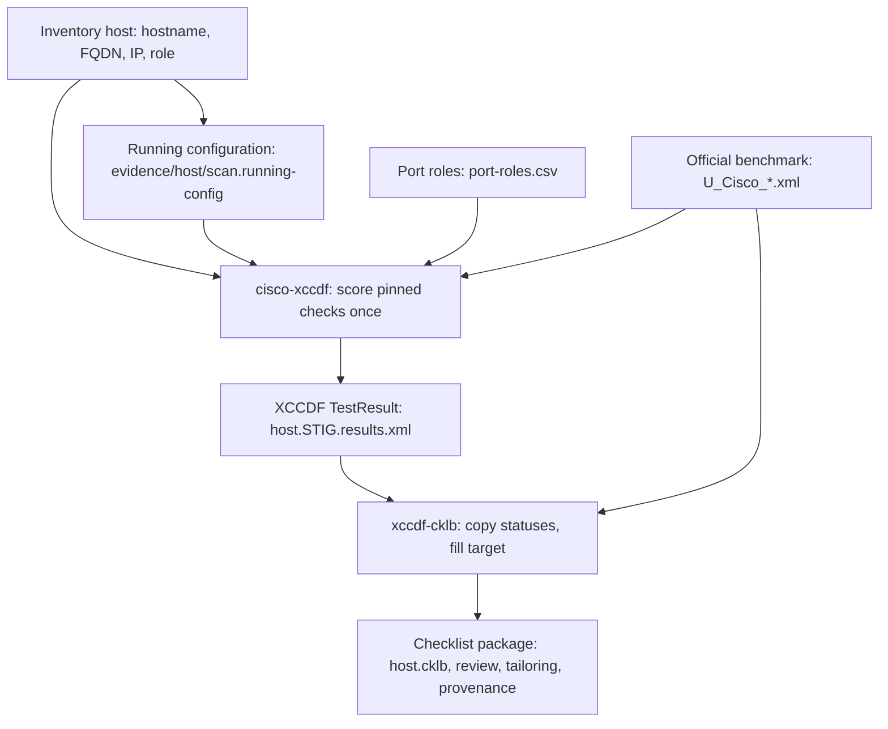

# Cisco network scan

Install and the command table are in [install and run](README.md). This page is the picture of the scan row: one saved configuration in, one device-named checklist out.

The collector, which is not this binary, supplies the switch's hostname, FQDN, management IP, and role. `cisco-xccdf` scores the pinned checks into an XCCDF result named for that switch, and `xccdf-cklb` copies those statuses onto a checklist whose target page carries the hostname, FQDN, management IP, and MAC.

The sample run on 15 Nov 2026 covered **3** switches, **6** checklists, **33** open rules, and **44** rules that still need a person.

## Pipeline

`cisco-xccdf` and `xccdf-cklb` are the two converter commands. The official benchmark joins both the scoring step and the checklist join. Identity travels with the inventory into `cisco-xccdf`, then rides the result file into the checklist.

## Where a status comes from

Scoring happens once, inside `cisco-xccdf`, through `BuildCiscoReview`. `xccdf-cklb` builds a dummy configuration only so it can walk every official rule, then replaces each status with the scan result for that SV id.

| XCCDF result | Checklist status | When |
| --- | --- | --- |
| pass | Not a finding | A pinned check proved the rule |
| fail | Open | A pinned check proved the rule is unmet |
| notapplicable | Not applicable | The feature is absent from this device |
| notchecked | Not reviewed | The configuration cannot prove the rule |

Mapping is `netxccdf.ChecklistStatus`. Counts below are the sample inventory on 15 Nov 2026.

## What the binary does

A collector outside the archive saves `scan.running-config` in a directory named for the hostname. The repository contains an example Ansible role for that collection. It is not the install, and the release archive does not run it.

| Step | Where it lives | What it does |
| --- | --- | --- |
| 1. Identity gate | `netxccdf.Identity.Normalize` and the hostname check in `cisco-xccdf` | Requires an FQDN beginning with the hostname, a management IP, a MAC, a role, and a target type. The configuration's `hostname` command must equal `--target` |
| 2. Name gate | `RequireResultsPath` | The result must be `scans/<host>/<host>.<benchmark>.results.xml` |
| 3. Score | `draft.BuildCiscoReview` and `ciscoconfig.Evaluate` | Pinned IOS, IOS-XE, and NX-OS checks set a status. Anything unproved stays Not reviewed. Evaluator `cisco-config-review-v9`. A tailoring file beside `scan.running-config` is applied before the result is written |
| 4. Write the scan | `netxccdf.FromChecklist` | XCCDF 1.2 TestResult: `target` is the hostname, `target-address` is the IP, asset facts hold FQDN and MAC, and `config-complete` records whether the snapshot is complete |
| 5. Convert | `draft.BuildFromNetworkScan` | Joins each rule-result to the official SV id and fills `target_data` from those facts |
| 6. Package | `writeReviewBundle` | Writes `<host>.cklb`, `<host>.cklb.provenance.json`, `<host>.review.html`, and `<host>.tailoring.yaml` inside `checklists/<benchmark>/<host>/` |

## Rule statuses on the six sample checklists

Vertical axis: device and STIG. Horizontal axis: rules (count).

| Device and STIG | Open | Not reviewed | Not applicable | Not a finding | Rules |
| --- | --- | --- | --- | --- | --- |
| IOS L2S | 4 | 1 | 2 | 15 | 22 |
| IOS NDM | 10 | 12 | 3 | 10 | 35 |
| IOS-XE L2S | 5 | 0 | 2 | 15 | 22 |
| IOS-XE NDM | 10 | 11 | 3 | 18 | 42 |
| NX-OS L2S | 3 | 5 | 2 | 12 | 22 |
| NX-OS NDM | 1 | 15 | 0 | 26 | 42 |

Source: `dist/network-stig-scan` checklists from `ansible/inventories/network-prototype.yml`. Generated 15 Nov 2026. 185 rules across six checklists: 33 open, 44 not reviewed, 12 not applicable, 96 not a finding.

## Files named for each switch

| Switch | STIG | Open | Not reviewed | N/A | Not a finding | Rules |
| --- | --- | --- | --- | --- | --- | --- |
| ios-switch-01 | Cisco_IOS_Switch_L2S_STIG | 4 | 1 | 2 | 15 | 22 |
| ios-switch-01 | Cisco_IOS_Switch_NDM_STIG | 10 | 12 | 3 | 10 | 35 |
| ios-xe-switch-01 | Cisco_IOS_XE_Switch_L2S_STIG | 5 | 0 | 2 | 15 | 22 |
| ios-xe-switch-01 | Cisco_IOS_XE_Switch_NDM_STIG | 10 | 11 | 3 | 18 | 42 |
| nx-access-01 | Cisco_NX-OS_Switch_L2S_STIG | 3 | 5 | 2 | 12 | 22 |
| nx-access-01 | Cisco_NX-OS_Switch_NDM_STIG | 1 | 15 | 0 | 26 | 42 |

Checklist path: `checklists/<STIG>/<host>/<host>.cklb`. Scan path: `scans/<host>/<host>.<STIG>.results.xml`.

## Checklist target page

`xccdf-cklb` copies these fields into CKLB `target_data`. The review page header shows the same line. The sample MACs are locally administered placeholders. The IPs are the management addresses already in those configurations.

| Host name | FQDN | IP address | MAC address | Role | Target type |
| --- | --- | --- | --- | --- | --- |
| ios-switch-01 | ios-switch-01.example.test | 192.0.2.3 | 02:00:00:00:00:03 | Access switch | Cisco IOS switch |
| ios-xe-switch-01 | ios-xe-switch-01.example.test | 192.0.2.4 | 02:00:00:00:00:04 | Access switch | Cisco IOS-XE switch |
| nx-access-01 | nx-access-01.example.test | 192.0.2.12 | 02:00:00:00:00:0c | Access switch | Cisco NX-OS switch |

## What stays with a person

A Not reviewed row is a design, architecture, or policy fact the running configuration cannot prove: the required banner text, an approved management network, a supported-release list, or a value the site defines. That reason is written on the row and again in `<host>.tailoring.yaml`. Copy the edited file beside `scan.running-config` as `<benchmark-id>.tailoring.yaml`. The next `cisco-xccdf` run for that device applies it.

`cisco-cklb` and `cisco-batch` score a saved configuration directly. The scan path scores with the same evaluator, then keeps the verdict in the XCCDF file so the checklist is built from that file. `<host>.cklb.provenance.json` binds the checklist bytes to that result, the benchmark, and the running-config SHA-256.

Command detail is in [Network scan](NETWORK-SCAN.md). The plain-language demo is in [Admin walkthrough](NETWORK-ADMIN-WALKTHROUGH.md).
