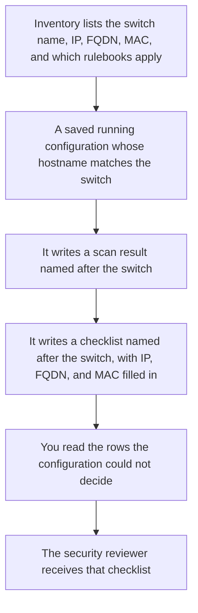
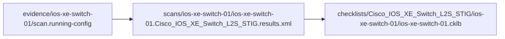

# How a switch becomes a checklist

This is the walkthrough for the demo. It uses ordinary names for the files a network admin already has, and it shows where each one goes.

A **STIG** is the rulebook for one kind of device. A Cisco switch has a separate rulebook for switch features (Layer 2) and for device management. A **checklist** is that rulebook filled in for one switch: each rule is marked met, not met, not applicable, or still needs a person. The file the security team opens is a **CKLB**. A **scan result** is the intermediate file that records those marks. It is the same kind of file OpenSCAP writes for a Linux host, so the rest of the review process can treat a switch and a server the same way.

The sample switches in this demo are invented. Their addresses are the documentation addresses already written in the sample configurations. The MAC addresses are locally administered placeholders (`02:…`) so the checklist fields are visible. A live inventory replaces every one of those values with the switch you manage.

## The path from the switch to the reviewer

One switch, one rulebook, three files:

The directory and the file both start with the switch hostname. Copy the file to a share and the name still says which switch it came from.

## The three sample switches

| Switch | Full name on the checklist | Management IP | MAC on the checklist | Rulebooks in the demo |
| --- | --- | --- | --- | --- |
| ios-xe-switch-01 | ios-xe-switch-01.example.test | 192.0.2.4 | 02:00:00:00:00:04 | IOS-XE switch Layer 2, IOS-XE device management |
| ios-switch-01 | ios-switch-01.example.test | 192.0.2.3 | 02:00:00:00:00:03 | IOS switch Layer 2, IOS device management |
| nx-access-01 | nx-access-01.example.test | 192.0.2.12 | 02:00:00:00:00:0c | NX-OS switch Layer 2, NX-OS device management |

The IP on each row is the management address in that sample configuration: VLAN 99 on the IOS switches, `mgmt0` on the NX-OS switch.

## What you click through

1. Put `scan.running-config` in a private directory named for the switch. The `hostname` command in that file has to be that directory's name. Then build the converter and run the two commands in [Network scan](NETWORK-SCAN.md): `cisco-xccdf` writes the result file, and `xccdf-cklb` writes the checklist, the review page, the worksheet, and `ios-xe-switch-01.cklb.provenance.json`.

2. Open the review page written beside the checklist. The link text you use in a demo index is the rulebook, then the switch name.

3. Open **Cisco_IOS_XE_Switch_L2S_STIG / ios-xe-switch-01**. The dark bar names the switch. The next line is the checklist identity:

   `ios-xe-switch-01.example.test · 192.0.2.4 · 02:00:00:00:00:04 · Access switch · Cisco IOS-XE switch · Network`

   Those same values are stored in the checklist file the security tool imports. Hostname, IP, FQDN, MAC, role, and technology area are filled in there.

4. Use the buttons to walk the rows in this order: **Open**, **Not reviewed**, **Not applicable**, then a sample of **Not a finding**.

5. Beside the checklist is `ios-xe-switch-01.tailoring.yaml`. Every row the configuration could not decide is listed there with the reason. Edit the rows that depend on the design of the network (which ports face users, which servers are the approved log hosts, which banner text the site requires). Copy the edited file beside `scan.running-config` as `Cisco_IOS_XE_Switch_L2S_STIG.tailoring.yaml`. The next `cisco-xccdf` run for that switch applies it.

6. The file you hand the security reviewer is:

   `dist/network-stig-scan/checklists/Cisco_IOS_XE_Switch_L2S_STIG/ios-xe-switch-01/ios-xe-switch-01.cklb`

   The scan result that produced it, if they ask where the marks came from, is:

   `dist/network-stig-scan/scans/ios-xe-switch-01/ios-xe-switch-01.Cisco_IOS_XE_Switch_L2S_STIG.results.xml`

## What the four colors mean

| What you see | Plain meaning | What you do |
| --- | --- | --- |
| Open | The configuration shows the rule is not met. | Fix the switch, or tell the reviewer why the site accepts it. |
| Not a finding | The configuration shows the rule is met. | Spot-check a few. The reviewer still owns the sign-off. |
| Not applicable | The rule is about a feature this switch does not use. | Confirm the feature really is absent. |
| Not reviewed | The configuration cannot prove the rule. The reason is on the row and in the tailoring file. | You supply the missing fact: a port role, an approved address, a site policy. |

A row stays Not reviewed when the answer is a design choice. Examples: the exact text of the login banner, which addresses are allowed to manage the switch, and whether a logging server is the approved one for the site. The playbook records the reason so you can fill that row without re-reading the whole rulebook.

## What each file is

| File | Who it is for |
| --- | --- |
| `scan.running-config` | The switch configuration the scan read. It stays in a folder named for the switch. |
| `port-roles.csv` | Your note of which ports face users, uplinks, or unused ports. Several switch rules need that note. |
| `<switch>.<rulebook>.results.xml` | The scan result, named for the switch. This is the file that looks like an OpenSCAP result. |
| `<switch>.cklb` | The checklist, named for the switch, with the IP, FQDN, and MAC filled in. |
| `<switch>.review.html` | The same checklist as a page you can read in a browser. |
| `<switch>.tailoring.yaml` | Your worksheet for the rows that still need a person. |

## When the switch is a real switch

Save its running configuration outside this tool, in a directory named with the same hostname the switch reports. Pass that hostname, the asset FQDN, the management IP, the management MAC, the role, and the target type to `cisco-xccdf`. The result file and the checklist stay named `access-sw-01`. `access-sw-01.cklb.provenance.json` records the hashes a reviewer can check without opening the configuration.

The command list and the private-file rules are in [Network scan](NETWORK-SCAN.md).
