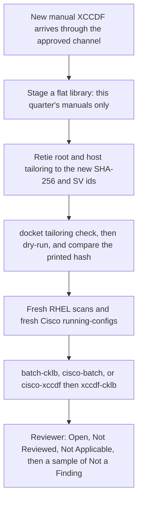

# Quarterly STIG run (draft)

**Status: draft for review.** This is the admin procedure for one publication cycle. It is not an approved site SOP, and it is not in the disconnected archive until this draft is accepted.

Run it each quarter when DISA publishes updated manual benchmarks for the products you assess. The trigger is that publication, not a change on a host. Finish the cycle for every in-scope RHEL major and every Cisco benchmark you actually score. A product that did not get a new manual this quarter stays on the manual already in the active library. Record that.

`docket` does not download benchmarks, scan a guest, log into a switch, approve a finding, or deliver evidence. You collect the new manuals and the new evidence. The binary writes private review checklists and provenance sidecars. A person still reviews them. Details of one run live in [Workflow](WORKFLOW.md), [Install and run](README.md), [Tailoring](TAILORING.md), [Batch CKLB](BATCH-CKLB.md), and [Cisco config](CISCO-CONFIG.md).

## What you finish the quarter with

- One active library that contains only this quarter's manuals and the tailoring pinned to those exact bytes.
- A fresh OpenSCAP result for every in-scope RHEL host, fetched into a tree that contains this quarter only.
- A fresh running configuration for every in-scope Cisco device, with `port-roles.csv` reviewed if the cabling changed.
- New CKLB review files and provenance sidecars whose benchmark hash is this quarter's manual.
- A short record of what changed, what decision you carried forward, and what you refused to carry forward.
- Last quarter's manuals, tailoring, scans, configs, and checklists kept outside the active paths, until this quarter's review is accepted.

## Use a binary that knows layered tailoring

The installed `docket` has to be the build from this tree (or a later one). Confirm the command exists before the quarter starts:

```sh
docket tailoring check --help
```

If that command is missing, install the current release with [install and run](README.md) before you touch the library. An older binary will not enforce the benchmark pin this procedure relies on.

## Keep the active paths flat and this-quarter-only

Use one owner-private library, mode `0700`, files mode `0600`, no symlinks. Keep it **flat**: manuals and root tailoring files sit in the same directory.

| Path | What belongs there this quarter |
| --- | --- |
| `/private/stig-library` | This quarter's manual XCCDF files and the root tailoring pinned to them. Nothing else. |
| `/private/stig-archive/<quarter>` | Last quarter's manuals and the tailoring that was pinned to them. |
| `/private/inventory/<quarter>` | This quarter's RHEL scan tree only. Pass this as `--input-root`. |
| `/private/evidence/<host>` | The current `scan.running-config` for that device. |
| `/private/evidence-archive/<quarter>` | The config you replaced. |
| `/private/scans`, `/private/checklists` | Device-named Cisco results. Move last quarter out before writing. |
| `/private/cisco-review` | `cisco-batch` output. Old files remain beside new ones because the name includes a hash. |

`batch-cklb` and the Cisco commands walk **subdirectories** of `--library-root` and take the highest version, then the highest release, for each RHEL major or Cisco benchmark ID. Two files with the same version and release, in any subdirectory, fail the run. A newer file left in an `old/` folder becomes the benchmark for every host. Archive last quarter **outside** `--library-root`.

`tailoring check` does not walk subdirectories, and when several manuals match one benchmark ID it opens the first lexical name rather than the highest version and release. A flat library with one manual per benchmark ID makes the check and the conversion look at the same file. Read the `BENCHMARK` line from `--dry-run` and confirm its SHA-256 is the hash you pinned.

RHEL root tailoring is loaded from the directory you pass as `--library-root`. Cisco root tailoring is loaded from the directory that holds the selected XML. In a flat library those are the same directory. `generate-cisco-tailoring.py` also requires a flat library and refuses to replace a tailoring file that is already there.

## Order of the quarter



Do the library and the tailoring before the scans. A scan against a library whose tailoring still names last quarter's hash fails closed, which is what you want, and it wastes the scan window.

## 1. Take the new manuals

Obtain the official DISA **manual** XCCDF for each product you assess, through the channel your site already trusts. The SSG datastream on a RHEL guest (`ssg-rhelN-ds.xml`) is the scan content. It is not the manual benchmark and it does not go in the library.

Expected names:

| Family | Filename |
| --- | --- |
| RHEL | `U_RHEL_<major>_STIG_V<version>R<release>_Manual-xccdf.xml` |
| Cisco | `U_Cisco_..._V<version>R<release>_Manual-xccdf.xml` |

The filename's version and release must match the benchmark `id`, the XML `version`, and `release-info`. RHEL majors in use are 7, 8, 9, and 10. Cisco IDs are whatever the manifest or `--benchmark-id` already names (`Cisco_IOS_XE_Switch_L2S_STIG`, and the rest). A new release usually keeps that ID and changes `V`/`R`.

Put the new files in an empty staging directory, not on top of the live library:

```sh
install -d -m 700 /private/stig-stage
# after extracting only the manuals you intend to use this quarter:
install -m 600 /transfer/U_RHEL_9_STIG_V2R11_Manual-xccdf.xml /private/stig-stage/
sha256sum /private/stig-stage/*.xml | tee /private/stig-stage/SHA256SUMS
chmod 600 /private/stig-stage/SHA256SUMS
```

One manual per RHEL major, and one manual per Cisco benchmark ID. Adding a higher version or release makes the **next** conversion use it for every host of that OS, including old scans if those scans are still under `--input-root`. That is a reinterpretation of saved results. This procedure uses a fresh scan instead, and still limits `--input-root` to this quarter so old results are not reinterpreted by accident.

## 2. Retie tailoring to those bytes

A decision carries forward only when all three are true:

1. The `stig_id` (`V-…`) still exists in the new manual.
2. The `sv_id` (`SV-…r…_rule`) is still the rule ID on that group. A new `r` number is a revised rule.
3. Someone re-read the new check text and the old comment still describes this site.

If the SV id changed, drop the row. Write a new decision after reading the new check. Do not paste the old comment onto the new SV id.

Schema version 2 is the form to use for this cycle. It stores `benchmark_sha256`. Any byte change in the manual then fails the run until you update the pin. Older RHEL templates without that field, and Cisco files still marked `schema_version: 1`, keep applying when the V/SV pair is unchanged even though the rest of the manual moved. Move them to version 2 this quarter.

### RHEL root (site-wide, partial)

File: `/private/stig-library/RHEL_<major>_STIG.tailoring.yaml`, once the staging directory becomes the library. List only the controls that differ from the scan. `rules: []` is a real empty policy.

On schema version 2, a root `auto` row has **no** comment. Any other status needs a comment. The packaged `templates/RHEL_9_STIG.tailoring.yaml` contains a lab-specific `not_a_finding`. Do not copy the templates over the live policy.

Set `benchmark_id` and `benchmark_sha256` from the staged manual:

```sh
sha256sum /private/stig-stage/U_RHEL_9_STIG_V2R11_Manual-xccdf.xml
```

```yaml
schema_version: 2
benchmark_id: RHEL_9_STIG
benchmark_sha256: <sha256 of this quarter's manual>
rules:
  - rule_name: sudo_remove_nopasswd
    stig_id: V-258106
    sv_id: SV-258106r1102061_rule
    status: not_a_finding
    comment: "Passwordless sudo is required for the automation account. Re-approved for this quarter's manual."
```

### RHEL host (one directory, partial)

File: `<host-scan-dir>/RHEL_<major>_STIG.tailoring.yaml`, beside this quarter's `*.results.xml`. The host directory name is the XCCDF `TestResult/target`.

Every host row needs a comment, including `auto`. `auto` means "on this host, ignore the root decision and keep the scan result." Host files are schema version 2 only. Point `benchmark_sha256` at the same manual as the root file. Remove a host row whose root rule was dropped because the SV id changed. A host row for an unknown V/SV pair fails the run.

### Cisco root (full inventory)

The root file lists **every** control in that manual exactly once. Regenerate it from the new XML, then put site decisions back by hand.

`generate-cisco-tailoring.py` will not overwrite an existing YAML. Point it at the staging directory while that directory has XML and no tailoring files:

```sh
python3 scripts/generate-cisco-tailoring.py --library-root /private/stig-stage --dry-run
python3 scripts/generate-cisco-tailoring.py --library-root /private/stig-stage
```

The script writes schema version 2, `benchmark_id`, `benchmark_sha256`, and `status: auto` with no comment for every rule. It does not copy last quarter's overrides.

Replay overrides from the archived root file:

- Same V and same SV: you may restore `open`, `not_a_finding`, `not_applicable`, or `not_reviewed`, with the comment, after re-reading the check.
- Same V, new SV: leave `auto`. Decide again.
- V removed: do not invent a row.
- V added: leave `auto` unless you already have a site decision for that new check.

An all-`auto` inventory does not make an unscored rule compliant. It accounts for every rule.

### Cisco host (one device, partial)

File: `/private/evidence/<host>/<benchmark-id>.tailoring.yaml`, beside `scan.running-config`. Same schema version 2 pin and the same comment rule as a RHEL host file, including a comment on `auto`.

`cisco-batch` and `xccdf-cklb` also write a worksheet beside the checklist. That worksheet is a suggestion. It is still `schema_version: 1`, and it lists the whole benchmark. A host override must be schema version 2 and partial, so copying the worksheet into the device directory unchanged fails the next run. Mine it for new Not Reviewed rows, edit those rows, and merge them into the existing host file. Leave the root file as the place where a decision applies to every device that does not have its own copy.

### Swap the library

After the new root files are in the staging directory:

```sh
# last quarter leaves the active path entirely
mv /private/stig-library /private/stig-archive/<previous-quarter>
mv /private/stig-stage /private/stig-library
chmod 700 /private/stig-library
chmod 600 /private/stig-library/*
```

Host files stay next to the evidence. Update their `benchmark_sha256` in place, or the first conversion stops on `benchmark_sha256 mismatch`.

## 3. Check the pin, then dry-run

```sh
docket tailoring check \
  --library-root /private/stig-library \
  --scan-root /private/inventory/<quarter>
```

Cisco device directories are not under the RHEL inventory. Check them too. `tailoring check --scan-root` walks every `*.tailoring.yaml` under the path you give it, so you can point a second run at the evidence root:

```sh
docket tailoring check \
  --library-root /private/stig-library \
  --scan-root /private/evidence
```

`VALIDATION FAILED` stops the quarter. Fix the reported file. Typical causes, and the fix:

| Message | What you do |
| --- | --- |
| `benchmark_sha256 mismatch` | Put this quarter's hash in that file, or you edited the wrong copy of the manual. |
| `unknown or mismatched STIG/SV ID` | The rule was revised or removed. Drop the row or look up the new SV id and write a new comment. |
| `incomplete control inventory` | A Cisco root file is missing rows. Regenerate, then replay overrides. |
| `comment required` | Root non-`auto` rows, and every host row, need a comment. Root `auto` rows on schema version 2 must not have one. |
| `host override files must use schema_version 2` | The worksheet was copied into the device directory. Rewrite it as a partial schema version 2 file. |

Then preview. `scripts/preflight-offline.sh` checks private trees, runs `tailoring check`, and runs `batch-cklb --dry-run`. A tailoring failure inside preflight is printed as a warning and preflight continues; the dry-run itself still exits non-zero when tailoring will not load. Read both. `Preflight complete` means no write was requested. It does not mean the tailoring passed if a warning was printed above it.

```sh
./scripts/preflight-offline.sh \
  --converter "$(command -v docket)" \
  --input-root /private/inventory/<quarter> \
  --library-root /private/stig-library
```

For each `BENCHMARK` line, confirm the path is the file you staged and the printed SHA-256 matches `benchmark_sha256` in that OS's root file. The same for each `TAILORING ROOT` and `TAILORING HOST` line.

Cisco preview is separate. Preflight does not run it.

```sh
docket cisco-batch \
  --manifest /private/cisco-manifest.json \
  --evidence-root /private/evidence \
  --library-root /private/stig-library \
  --output-root /private/cisco-review \
  --dry-run
```

The manifest lists hosts, platforms, and benchmark IDs. You change it when a device or a benchmark ID is added or removed. A new V/R of the same ID needs no manifest edit. The dry-run prints open / not a finding / not applicable / not reviewed counts and writes nothing.

`cisco-xccdf` has no dry-run. The result file is the first write. Use `cisco-cklb --dry-run` on one device first if you want a preview of the same pinned checks.

## 4. Collect this quarter's evidence

### RHEL

The scan is the lab playbook outside this repository. [Lab scan source](OSCAP-SOURCE.md) is the picture: one `oscap xccdf eval`, profile `stig_gui`, no `--remediate`. The playbook updates `openscap` and `scap-security-guide` on the guest before it scans. That package update is a change to the guest, and the SSG release is not the DISA manual release. Record the SSG package version from the scan log next to the manual's version and release. A manual can move before SSG references do. Extra Not Reviewed rows are the usual result, and they stay Not Reviewed until a person tailors them or a later scan maps them.

Fetch into `/private/inventory/<quarter>/.../<fqdn>/`. The leaf directory name equals `TestResult/target`. Each run is `<prefix>.results.xml` plus optional `<prefix>.report.html` and `<prefix>.results.arf.xml` with the same prefix. The stig-viewer export and the scan log stay in the tree and are ignored by conversion.

If the lab hands you an asset record, check it separately. Batch conversion does not read it.

```sh
docket asset-check \
  --asset /private/asset.json \
  --pre /private/pre.xml \
  --host node.example.test
```

### Cisco

Save a new running configuration into the directory named for the hostname. Archive the previous file first; the input path is not versioned.

```sh
install -d -m 700 /private/evidence-archive/<previous-quarter>/<host>
install -m 600 /private/evidence/<host>/scan.running-config \
  /private/evidence-archive/<previous-quarter>/<host>/scan.running-config
# then install the new snapshot at mode 0600
```

The `hostname` command in the file must equal the directory name and `--target`. Keep `port-roles.csv` when the cabling is unchanged. Its hash is part of the checklist identity, so an edit produces a different output name. Review it when ports changed. Roles are `user`, `uplink`, `unused`, `access-switch`, and `routed`.

An incomplete snapshot (IOS missing `end`, NX-OS missing a version line and hostname) does not turn a missing command into a finding. The review page says when the snapshot is incomplete. Collect a complete one before you call the quarter done.

## 5. Write the checklists

RHEL, after the dry-run printed the manuals you meant:

```sh
docket batch-cklb \
  --input-root /private/inventory/<quarter> \
  --library-root /private/stig-library
```

Each scan gets a new file beside it:

`<prefix>-disa-<benchmark-hash>-<bundle-hash>-ASSESSMENT.cklb`

and `<name>.cklb.provenance.json`. A new manual or a new tailoring file changes the name, so last quarter's checklist stays on disk if it was in this directory. It should not be in this directory. You pointed `--input-root` at this quarter.

A repeated run with the same bytes prints `SKIP`. If the checklist bytes match and the provenance sidecar does not (a path changed, or the sidecar was edited), the run prints `WARNING: ... provenance changed` and rewrites that pair. That warning is for a bad sidecar on the same inputs. It is not the signal of a new STIG. A new STIG has a new benchmark hash in the filename.

Cisco, many devices:

```sh
docket cisco-batch \
  --manifest /private/cisco-manifest.json \
  --evidence-root /private/evidence \
  --library-root /private/stig-library \
  --output-root /private/cisco-review
```

Output is `/private/cisco-review/<benchmark-id>/<host>/scan-cisco-<benchmark-hash>-<bundle-hash>-ASSESSMENT.cklb`, plus `.provenance.json`, `.review.html`, `.tailoring.yaml`, and an `index.html`. Same rule: a new manual produces a new name. The worksheet `.tailoring.yaml` is the suggestion from step 2, not the applied host file.

Cisco, device-named result. These paths do **not** include the release. `cisco-xccdf` and `xccdf-cklb` write them with the same exclusive create as the other commands: an identical file is skipped, and a different file already at that path fails with `existing output differs from current conversion`. A new quarter's result is different, so move last quarter aside first:

```sh
mkdir -p /private/scans-archive/<previous-quarter> /private/checklists-archive/<previous-quarter>
mv /private/scans/<host> /private/scans-archive/<previous-quarter>/<host>
mv /private/checklists/<benchmark-id>/<host> /private/checklists-archive/<previous-quarter>/<benchmark-id>-<host>
```

Then the two writes from [Network scan](NETWORK-SCAN.md):

```sh
docket cisco-xccdf \
  --config /private/evidence/<host>/scan.running-config \
  --target <host> \
  --fqdn <host>.example.test \
  --ip <management-ip> \
  --mac <management-mac> \
  --role "<role>" \
  --target-type "<target type>" \
  --library-root /private/stig-library \
  --benchmark-id <benchmark-id> \
  --port-roles /private/evidence/<host>/port-roles.csv \
  --out /private/scans/<host>/<host>.<benchmark-id>.results.xml

docket xccdf-cklb \
  --results /private/scans/<host>/<host>.<benchmark-id>.results.xml \
  --library-root /private/stig-library \
  --out /private/checklists/<benchmark-id>/<host>/<host>.cklb
```

Repeat for each benchmark ID that device is scored against. `xccdf-cklb` copies the statuses already written into the result. Tailoring is applied by `cisco-xccdf`, so fix a host file and rerun `cisco-xccdf` into a new results path. The old results file will not pick up the edit.

## 6. Hand off for review

For each new checklist, open the sidecar and check:

- `benchmark.path` and `benchmark.sha256` are this quarter's manual. On a device-named `xccdf-cklb` sidecar the benchmark is `benchmark.sha256` and the applied tailoring is the single `tailoring_sha256` of the merged files.
- On `batch-cklb` and `cisco-batch` sidecars, `tailoring_root` and `tailoring_host` are the files you just pinned, or absent where you have no policy.
- Where `tailoring_rule_layer` is present, it says `root` or `host` for each overridden `V-` id, and that matches where you edited the row.

Review order, on the CKLB or on the Cisco `.review.html`: **Open**, then **Not Reviewed**, then **Not Applicable**, then a sample of **Not a Finding**. Also list, against last quarter:

- controls that became Open
- controls whose SV id changed
- decisions you dropped instead of carrying forward
- hosts and devices that were not rescanned

Optional, and only when Checkmate is installed separately: `preflight-offline.sh` with `--checkmate`, `--checklist-root`, and `--schema`. That is an inventory and a schema check. Editing a CKLB in Checkmate makes the sidecar hash stale. Import one representative checklist per benchmark into STIG Viewer before anyone calls the quarter adopted.

Approval, exceptions, signing, and delivery stay outside this repository. The sidecar hash proves these bytes. It does not approve them, and it does not prove an SSG check and a DISA check are the same test.

## 7. Close the quarter

Keep this record with the archived library. Fill it in before you delete anything from the archive.

```text
Quarter:
DISA manuals (product, filename, version, release, sha256):
SSG package version per RHEL major, from the scan log:
docket version (`docket` build or release tarball name):
Active library path:
Archive path for the previous library:
RHEL input root:
Cisco evidence root:
Tailoring decisions carried forward (file, V-id, SV-id, status):
Tailoring decisions dropped because the SV id changed (file, old V-id, old SV-id):
Hosts or devices not rescanned, and why:
New checklist paths:
Reviewer:
```

Leave `/private/stig-archive/<previous-quarter>` in place until that review is done. The active library should already contain only the manuals you intend the next ordinary rerun to select.
