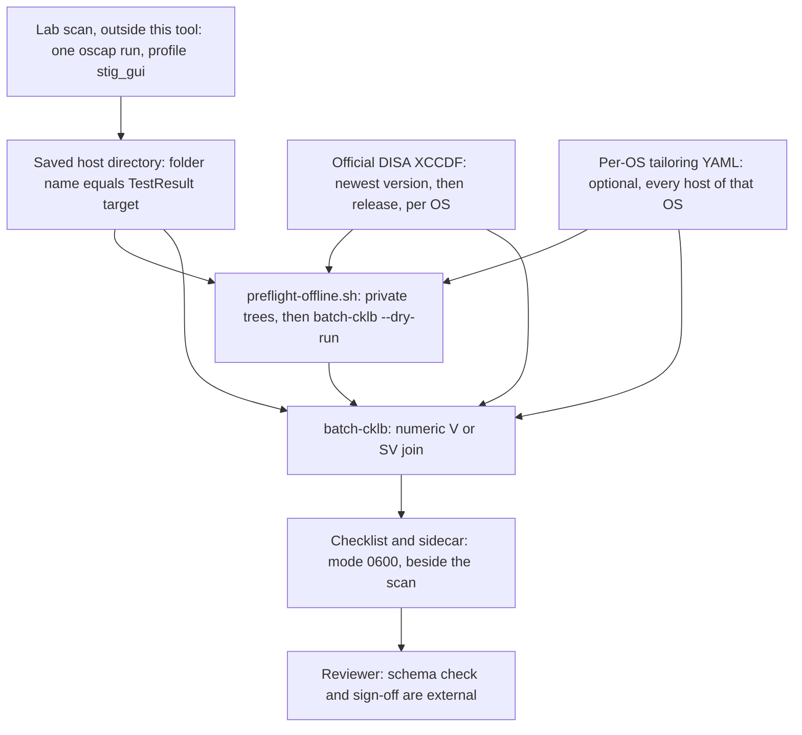

# RHEL OpenSCAP review workflow

Install, the shared library, and the command table are in [install and run](README.md). This page is the picture of what happens after that.

The lab scans a RHEL guest once with OpenSCAP. This tool never runs that scan. It joins the saved SSG result to the newest official DISA manual benchmark for that RHEL major and writes a private checklist plus a provenance sidecar.

Accepted majors are **RHEL 7 through 10**. The lab playbook performs **one** scan. Untailored conversion uses provenance **v10**. A per-OS tailoring file uses provenance **v11**.

## From the guest to the reviewer

`preflight-offline.sh` and `batch-cklb` are the commands in this archive. The lab playbook lives in `/scratch/ansible` and is not part of the disconnected bundle. The bundle keeps non-executable snapshots of that playbook and its wrapper.

## How a rule gets its status

Each official control starts Not reviewed. A numeric `V-` or historical `SV-` reference can join an SSG result to that control. The join is an ID match. It does not prove that the SSG check and the DISA check mean the same thing.

| Mapped SSG results | Checklist status |
| --- | --- |
| Every mapped source passed | Not a finding |
| At least one mapped source failed | Open |
| Every mapped source is notapplicable | Not applicable |
| Missing, unselected, ambiguous, or another result | Not reviewed |

Source: `internal/reconcile`. Accepted profiles are `stig`, `stig_gui`, and the older RHEL 7 `stig-rhel7-disa` profile.

## What the lab hands over

The playbook installs or updates `openscap` and `scap-security-guide`, checks the `stig_gui` profile with `oscap info`, and evaluates once. Exit codes 0 and 2 are accepted. The command has no `--remediate` flag.

| File from the guest | Used by batch-cklb | Role |
| --- | --- | --- |
| `<prefix>.results.xml` | Required | XCCDF statuses and STIG references |
| `<prefix>.report.html` | Optional | Executed checks and values shown in the report |
| `<prefix>.results.arf.xml` | Optional, and only with the HTML | OVAL host observations |
| `<prefix>_XCCDF_Results.xml` | No | stig-viewer export, kept separately |
| `<prefix>_Scan.log` | No | Scanner diagnostics |

The host directory basename must equal `TestResult/target`. For `rhel9-node1` on guest date 2026-11-09 the ordinary result is `RHEL9-NODE1_2026-11-09.results.xml`. Source: [Lab scan source](OSCAP-SOURCE.md).

## Historical v6 review candidates

Vertical axis: saved scan. Horizontal axis: official controls (count). The four series are the checklist statuses from the `assessment-provenance-v6` conversion.

| Saved scan | Open | Not reviewed | Not applicable | Not a finding | Controls |
| --- | --- | --- | --- | --- | --- |
| RHEL 8 | 198 | 42 | 22 | 109 | 371 |
| RHEL 9 node1 | 27 | 35 | 17 | 366 | 445 |
| RHEL 9 node2 A | 26 | 39 | 8 | 372 | 445 |
| RHEL 9 node2 B | 26 | 39 | 8 | 372 | 445 |
| RHEL 10 | 35 | 22 | 27 | 351 | 435 |

Source: [Batch CKLB](BATCH-CKLB.md) historical v6 readback. Library selection was RHEL 8 V2R9, RHEL 9 V2R10, and RHEL 10 V1R3. The two RHEL 9 node2 scans have the same counts. A later RHEL 9 node1 conversion in the v10 format is 362 not a finding, 27 open, 17 not applicable, and 39 not reviewed, and is not in the table above.

## Commands on the disconnected host

| Step | Command | What it writes |
| --- | --- | --- |
| Check the handoff | `asset-check --asset --pre --host` | Nothing. It checks the asset record against the supplied pre-scan bytes. |
| Preview | `preflight-offline.sh`, then `batch-cklb --dry-run` | Nothing. It prints the newest benchmark and any tailoring file it would use. |
| Convert | `batch-cklb --input-root --library-root` | `<prefix>-disa-<benchmark-hash>-<bundle-hash>-ASSESSMENT.cklb` and a matching `.cklb.provenance.json` |
| Optional inventory | `checkmate --list`, and `--validate --schema` when supplied | A count or a schema result. `checkmate` is in the same archive as `docket`. |

## A hash identifies bytes

The provenance sidecar binds the checklist to the scan, the benchmark, and any HTML, ARF, or tailoring file. It does not sign the assessment, approve a finding, or show that an SSG check and a DISA check are the same test. `auto` in the per-OS YAML keeps the scan status and adds a comment. Any other status needs a comment and is recorded as an administrator decision. The packaged RHEL 9 example includes a lab-specific not-a-finding override and is not site policy.

Pairing rules are in [Batch CKLB](BATCH-CKLB.md). The operational sequence is in [Workflow](WORKFLOW.md).
